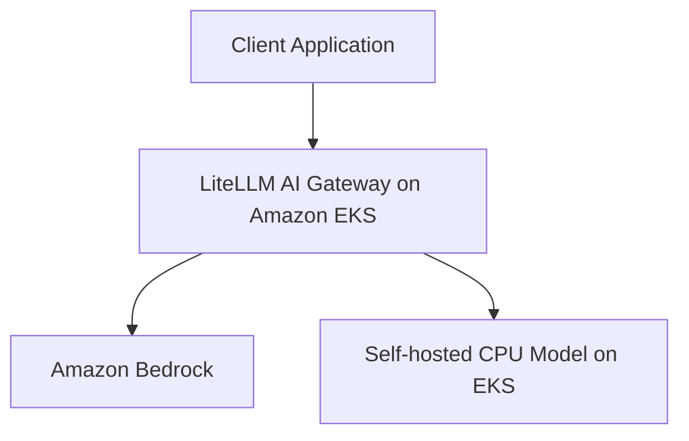

# Building an AI Gateway on AWS & Kubernetes

Build an OpenAI-compatible AI Gateway on Amazon EKS that routes requests to Amazon Bedrock or a self-hosted language model.

This repository accompanies a three-part technical blog series covering architecture, infrastructure, implementation, scaling, and operational considerations.

> **Project status:** Initial setup. Infrastructure and application deployment instructions will be added as the demo is built.

## Architecture



## Blog Series

### Part 1: One API, Multiple Models

**Building an AI Gateway with Amazon Bedrock and Amazon EKS**

- Provision infrastructure using Terraform.
- Deploy LiteLLM on Amazon EKS.
- Route requests to Amazon Bedrock and a self-hosted CPU model.
- Test both backends through a common API.

### Part 2: Scaling Self-Hosted Inference

**GPU Workloads, Karpenter, and Cost Optimization**

- Introduce GPU-backed worker nodes.
- Explore Karpenter provisioning and workload scheduling.
- Investigate autoscaling and Spot capacity.
- Compare CPU and GPU inference trade-offs.

### Part 3: Productionizing the AI Gateway

**Observability, Security, Reliability, and Cost Visibility**

- Add metrics, logs, and tracing.
- Apply authentication, authorization, and rate limiting.
- Explore timeouts, retries, and failure handling.
- Improve model usage and cost visibility.

## Technology Stack

- Amazon EKS
- Amazon Bedrock
- Terraform
- LiteLLM
- Kubernetes and Helm
- A self-hosted model runtime
- GitHub and GitHub Actions
- AWS IAM and EKS Pod Identity

Exact versions and supported model configurations will be documented alongside the implementation.

## Repository Structure

```text
.
├── .github/
│   └── workflows/
├── kubernetes/
│   ├── litellm/
│   └── local-model/
├── scripts/
├── terraform/
├── .gitignore
└── README.md
```

## Prerequisites

The development environment is being prepared for:

- An AWS account with appropriately scoped permissions
- AWS CLI configured for the target account and region
- Terraform
- Docker
- kubectl
- Helm
- Git and GitHub CLI

The initial deployment will use `us-east-1` and CPU-based Kubernetes workloads. GPU infrastructure will be introduced in Part 2.

## Security Principles

- Use least-privilege IAM permissions.
- Prefer EKS Pod Identity for workload access to AWS services.
- Use GitHub Actions OIDC instead of long-lived AWS access keys in CI/CD.
- Never commit credentials, private keys, Terraform state, or secrets.
- Review Terraform plans before applying infrastructure changes.
- Keep deployment and cleanup instructions explicit.

## Cost and Cleanup

Running this demo can incur AWS charges, including EKS cluster usage, EC2 instances, storage, networking, and model inference.

Review costs before deploying resources. Follow the cleanup instructions added with each implementation milestone when the environment is no longer needed.

Destroying infrastructure may delete resources and data. Review the Terraform plan and retain any data you need before cleanup.

## CI/CD

GitHub Actions will validate code and infrastructure changes. The planned workflow includes formatting, Terraform validation, security checks, and controlled deployment using AWS OIDC.

CI/CD is a repository engineering practice and is not a primary focus of the accompanying blog tutorials.

## Contributing

Issues, suggestions, and improvements are welcome. Please open an issue to discuss significant changes before submitting a pull request.

## License

A license will be added before the project is published for reuse.
