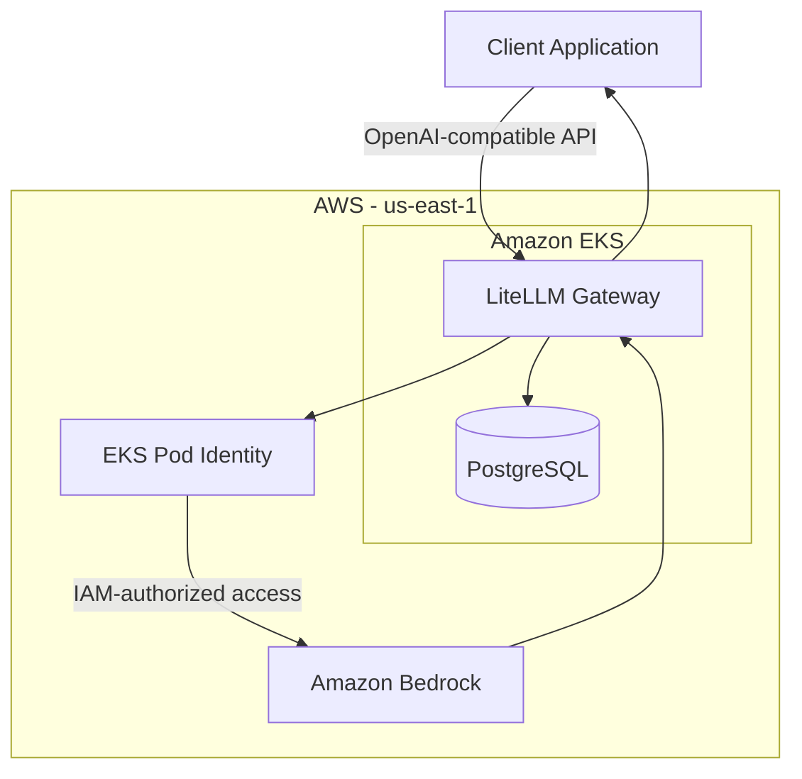

# Building an AI Gateway on AWS & Kubernetes

Build an OpenAI-compatible AI gateway on Amazon EKS using LiteLLM, Amazon Bedrock, and Terraform. This project explores how to create a common API for LLM inference on AWS, then extend it toward self-hosted models, GPU scheduling, observability, and operational controls.

> **Project status:** Part 1 — LiteLLM on EKS with Amazon Bedrock is deployed and tested. Self-hosted inference, GPU workloads, CI/CD, and advanced observability are planned follow-up milestones.

## Architecture

### Current implementation



LiteLLM exposes an OpenAI-compatible API and routes requests to Amazon Bedrock. EKS Pod Identity provides AWS credentials to the gateway without embedding long-lived AWS access keys in the application.

### Planned architecture extensions

- Add a self-hosted CPU model on Kubernetes.
- Explore GPU-backed workloads, Karpenter, and autoscaling.
- Introduce metrics, logs, tracing, and improved cost visibility.
- Strengthen authentication, rate limiting, and reliability controls.

## Technology stack

- **Cloud:** Amazon Web Services
- **Container orchestration:** Amazon EKS and Kubernetes
- **AI gateway:** LiteLLM
- **Model provider:** Amazon Bedrock — Amazon Nova 2 Lite
- **Infrastructure as Code:** Terraform
- **Packaging:** Helm
- **Workload identity:** EKS Pod Identity
- **Database:** PostgreSQL
- **Source control:** GitHub

The current deployment uses the `us-east-1` AWS Region, one `t3.large` CPU worker node, and an 8 GiB PostgreSQL persistent volume.

## Repository structure

```text
.
├── .github/
│   └── workflows/
├── kubernetes/
│   ├── litellm/
│   │   └── values.yaml
│   └── local-model/
├── scripts/
└── terraform/
    ├── bootstrap-state/
    ├── backend.tf
    ├── backend.hcl.example
    ├── bedrock_litellm_identity.tf
    ├── ebs_csi.tf
    ├── main.tf
    ├── outputs.tf
    ├── providers.tf
    ├── terraform.tfvars.example
    ├── variables.tf
    └── versions.tf
```

## Prerequisites

Install and configure:

- An AWS account with permissions to create the required networking, EKS, IAM, EC2, S3, and related resources.
- AWS CLI configured with credentials for the intended account.
- Terraform.
- `kubectl`.
- Helm.
- Git.

The public EKS API endpoint is restricted to the IPv4 CIDR configured in `terraform/terraform.tfvars`. Use your own public IP address with a `/32` suffix.

## Deployment

### 1. Clone the repository

```bash
git clone https://github.com/iabhishek07/ai-gateway-aws-kubernetes.git
cd ai-gateway-aws-kubernetes
```

### 2. Bootstrap Terraform remote state

The state bootstrap configuration creates an S3 bucket with versioning, encryption, public-access blocking, and ownership controls.

```bash
cd terraform/bootstrap-state
terraform init
terraform plan
terraform apply
```

Review the plan before applying it. The state bucket has a `prevent_destroy` lifecycle safeguard.

### 3. Configure the Terraform backend

Return to the Terraform directory and create a local backend configuration:

```bash
cd ..
cp backend.hcl.example backend.hcl
```

Edit `backend.hcl` to use the S3 bucket created for your AWS account. The local `backend.hcl` file must not be committed.

### 4. Configure your EKS API access CIDR

```bash
cp terraform.tfvars.example terraform.tfvars
```

Edit `terraform.tfvars` and replace the example address with your public IPv4 address:

```hcl
cluster_endpoint_public_access_cidrs = ["YOUR_PUBLIC_IP/32"]
```

Keep `terraform.tfvars` local and uncommitted.

### 5. Provision the infrastructure

From the `terraform/` directory:

```bash
terraform init -backend-config=backend.hcl
terraform fmt -check -recursive
terraform validate
terraform plan -out=tfplan
```

Review the proposed changes, then apply the saved plan:

```bash
terraform apply tfplan
```

This provisions the VPC, EKS cluster, CPU node group, required EKS add-ons, and IAM resources for Bedrock access and EBS CSI.

### 6. Connect to the cluster

```bash
aws eks update-kubeconfig \
  --region us-east-1 \
  --name ai-gateway-demo

kubectl get nodes
```

Confirm that the worker node is `Ready` before continuing.

### 7. Deploy LiteLLM

The deployment uses the LiteLLM Helm chart version `1.103.0` and the configuration in `kubernetes/litellm/values.yaml`.

Before installing, create the `ai-gateway` namespace and `litellm` service account, and provision the `litellm-masterkey` Kubernetes Secret. Configure PostgreSQL credentials through a separate local Helm values file. Do not put credentials in the tracked values file.

Install the chart using your protected local secrets file:

```bash
helm upgrade --install litellm \
  oci://ghcr.io/berriai/litellm-helm \
  --version 1.103.0 \
  --namespace ai-gateway \
  --create-namespace \
  -f kubernetes/litellm/values.yaml \
  -f /path/to/local-secret-values.yaml \
  --wait \
  --timeout 10m
```

Replace the local secrets-file path with your own protected file. Never commit that file or print its contents in logs.

## Verify the deployment

Check the application, database, and persistent volume:

```bash
kubectl get pods,pvc -n ai-gateway
```

The LiteLLM pod and PostgreSQL pod should be running, and the PostgreSQL PVC should be `Bound`.

### Send an inference request

In one terminal, forward the gateway service:

```bash
kubectl port-forward -n ai-gateway svc/litellm 4000:4000
```

In another terminal, load the gateway key from the Kubernetes Secret without printing it:

```bash
export LITELLM_MASTER_KEY="$(
  kubectl get secret litellm-masterkey \
    -n ai-gateway \
    -o jsonpath='{.data.masterkey}' | base64 -d
)"
```

On macOS, use `base64 -D` instead of `base64 -d`.

Send a request to the OpenAI-compatible endpoint:

```bash
curl -sS http://localhost:4000/v1/chat/completions \
  -H "Authorization: Bearer ${LITELLM_MASTER_KEY}" \
  -H "Content-Type: application/json" \
  -d '{
    "model": "nova-2-lite",
    "messages": [
      {
        "role": "user",
        "content": "Explain Kubernetes in one sentence."
      }
    ]
  }'
```

A successful request returns a chat-completion response from Amazon Bedrock through LiteLLM.

Unset the local shell variable when you finish:

```bash
unset LITELLM_MASTER_KEY
```

## Security considerations

- Use least-privilege IAM policies.
- Use EKS Pod Identity for workload access to AWS services.
- Restrict public access to the Kubernetes API endpoint.
- Keep database credentials and gateway keys out of Git.
- Do not commit Terraform state, plan files, or local backend configuration.
- Review Terraform plans before applying changes.
- Treat this project as a learning environment, not a production-ready reference implementation.

## Cost considerations and cleanup

This deployment can incur ongoing AWS charges, including:

- EKS cluster control-plane usage.
- EC2 worker nodes.
- NAT Gateway and networking.
- EBS storage.
- Amazon Bedrock inference.

Keep the environment running only as long as needed for development and testing.

**Before cleanup:** Review the resources and data that will be affected. Back up anything you need, and inspect the Terraform destroy plan before proceeding.

```bash
cd terraform
terraform plan -destroy -out=destroy.tfplan
```

Only after reviewing and confirming the plan should you run:

```bash
terraform apply destroy.tfplan
```

The remote Terraform state bucket is intentionally protected and may remain after the main infrastructure is destroyed. Review and manage it separately if you no longer need it.

## Roadmap

### Part 1 — One API, Multiple Models

- [x] Provision AWS infrastructure with Terraform.
- [x] Deploy LiteLLM on Amazon EKS.
- [x] Configure IAM-based access to Amazon Bedrock.
- [x] Verify an OpenAI-compatible inference request.
- [ ] Add a self-hosted CPU model and route requests through the same API.

### Part 2 — Scaling Self-Hosted Inference

- [ ] Deploy GPU-backed workloads.
- [ ] Explore Karpenter and workload scheduling.
- [ ] Investigate autoscaling and Spot capacity.
- [ ] Compare CPU and GPU inference trade-offs.

### Part 3 — Productionizing the AI Gateway

- [ ] Add metrics, logs, and distributed tracing.
- [ ] Improve authentication and rate limiting.
- [ ] Explore retries, timeouts, and failure handling.
- [ ] Improve model usage and cost visibility.

## Contributing

Issues, suggestions, and improvements are welcome. Please open an issue to discuss significant changes before submitting a pull request.

## License

A license has not yet been added. Add one before inviting reuse or redistribution of the project.
